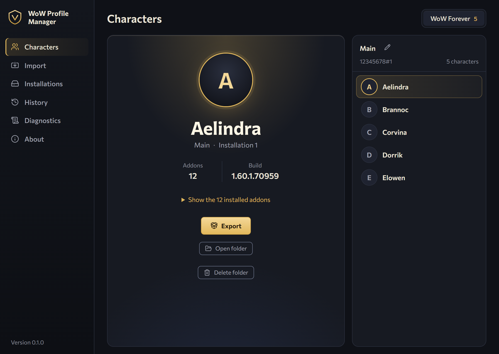
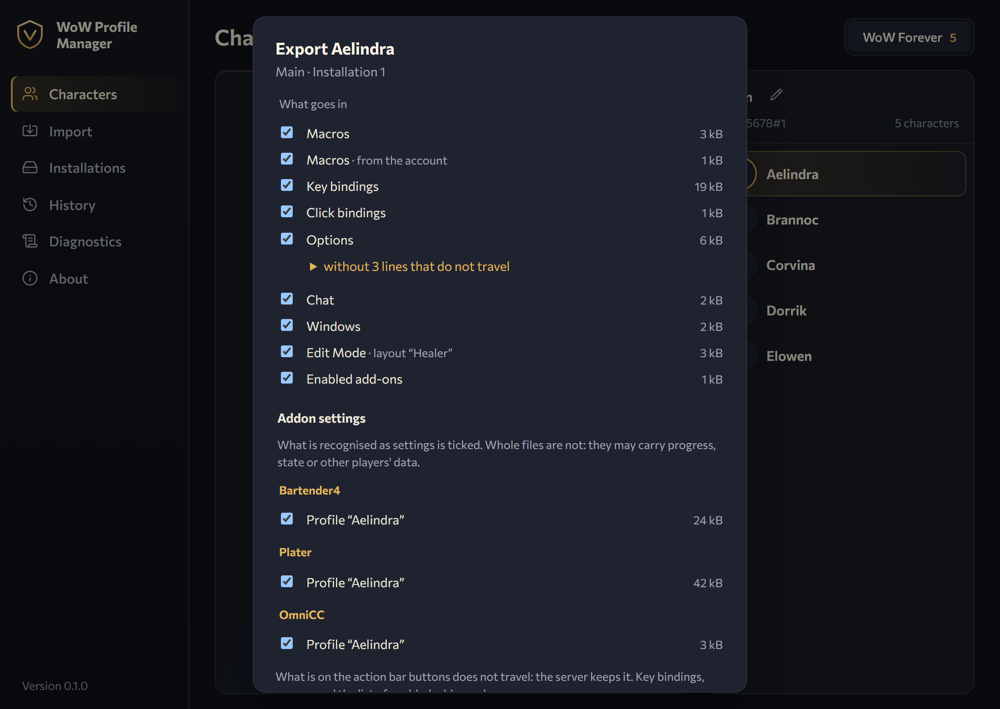
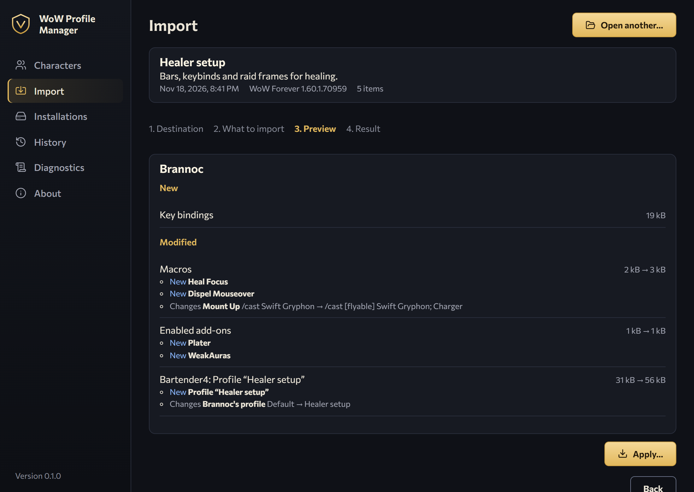
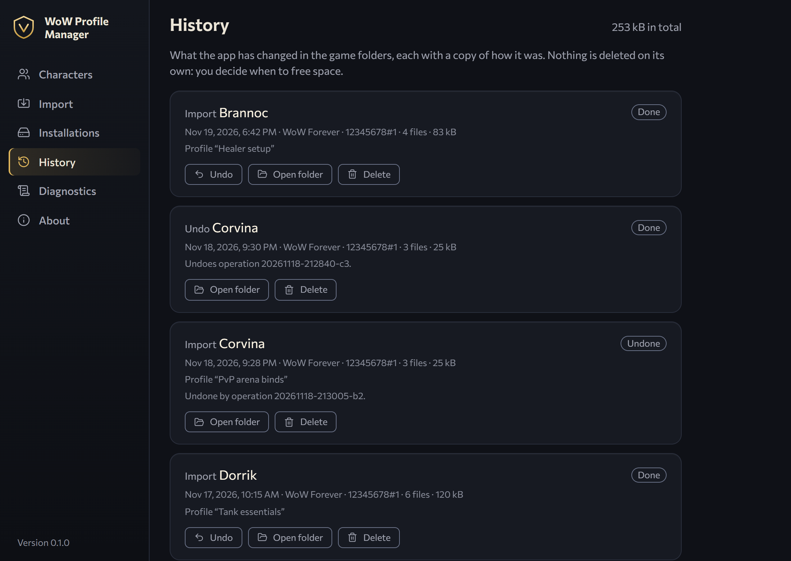

<div align="center">

# WoW Profile Manager

**Export a WoW Forever character's setup to a single file, share it, and apply it to another character, on another
computer, safely.**

[](https://github.com/SergioVertedor/wow-profile-manager/actions/workflows/calidad.yml)
[](LICENSE)




</div>

## What it does

WoW Profile Manager is a Windows desktop app for **WoW Forever**. It takes a character's configuration (add-ons and
their settings, macros, key bindings and action bar layout) and packs it into one portable `.wowprofile` file. Another
player opens that file, picks which of their own characters to apply it to and what to bring over, sees exactly what
will change, and applies it. Every import can be undone.

What sits inside each action bar button does not travel: the game server stores it, and each player places their own
abilities.

## Features

- **Finds your installations, accounts, realms and characters** on its own (Windows registry and Battle.net), or from
  a folder you add.
- **Exports a character** to a single `.wowprofile` file: macros, key bindings, click bindings, options, chat, windows,
  raid frames, enabled add-ons, **add-on settings** (AceDB profiles and dedicated adapters) and the character's **Edit
  Mode layout**, which is added to the destination account's layouts without replacing any.
- **Leaves out what should not travel**: state, other players' data and options that only make sense on the original
  computer.
- **Imports into any character**, even several at once and on another computer, choosing what to bring.
- **Shows a precise preview** before writing anything: every macro, key binding, add-on and profile that is added,
  changed or removed.
- **Backs up before every change** and keeps a **history with one-click undo**.
- **Never writes while the game is running**, and reads every package with strict checks: a profile is data, never
  code.
- **Portable**: a single `.exe` with its data folder next to it. Nothing in `%APPDATA%` or the Windows registry.
- **Signed updates**: on startup it can check GitHub for a new version and asks before installing it; only a build
  signed with the project's key is installed. It can be turned off, and then the app never goes online.
- **English and Spanish** interface, following the Windows language.

## Screenshots

<table>
  <tr>
    <td width="50%"></td>
    <td width="50%"></td>
  </tr>
  <tr>
    <td align="center"><b>Export</b>: choose what goes into the package.</td>
    <td align="center"><b>Import</b>: see exactly what will change before applying.</td>
  </tr>
  <tr>
    <td width="50%"></td>
    <td width="50%"></td>
  </tr>
  <tr>
    <td align="center"><b>History</b>: every change is backed up and can be undone.</td>
    <td align="center"><b>Characters</b>: every installation, account and character in one place.</td>
  </tr>
</table>

<sub>Screenshots use made-up data. They are generated from the real interface with
<code>node scripts/capturas.mjs</code>.</sub>

## Status

**Phase 3 (MVP), not released yet.** Detection, export, import, preview, backups, undo, the portable build and signed
updates work today; the first release is next. The roadmap lives in the
[issues](https://github.com/SergioVertedor/wow-profile-manager/issues).

## Documentation

The technical documentation is in Spanish (an English version is tracked in
[#80](https://github.com/SergioVertedor/wow-profile-manager/issues/80)):

| document | what it covers |
|---|---|
| [`formato-wowprofile.md`](docs/formato-wowprofile.md) | The `.wowprofile` package format, with its [JSON Schema](docs/wowprofile.schema.json). |
| [`compatibilidad-wow-forever.md`](docs/compatibilidad-wow-forever.md) | What was measured on a real WoW Forever installation. |
| [`adaptadores.md`](docs/adaptadores.md) | Add-on adapters: how add-on settings are read and written, with their [schema](docs/adaptador.schema.json). |
| [`flujos.md`](docs/flujos.md) | Export and import flows, backups and history, with the [operation schema](docs/operacion.schema.json). |
| [`modelo-de-datos.md`](docs/modelo-de-datos.md) | Data model: installations, accounts, characters and add-ons. |
| [`arquitectura.md`](docs/arquitectura.md) | Architecture: modules, responsibilities and who writes where. |

## Development

```powershell
git clone https://github.com/SergioVertedor/wow-profile-manager.git
cd wow-profile-manager
git switch develop
npm ci
```

Requirements (Windows): [Node.js](https://nodejs.org/) 24, stable [Rust](https://rustup.rs/) and the
[Visual Studio C++ build tools](https://tauri.app/start/prerequisites/). WebView2 already ships with Windows 11.

| what | command |
|---|---|
| Run in development mode | `npm run tauri dev` |
| Interface: types, linter and tests | `npm run typecheck`, `npm run lint`, `npm test` |
| Core: formatting, linter and tests (in `src-tauri/`) | `cargo fmt --check`, `cargo clippy --all-targets -- -D warnings`, `cargo test` |
| Regenerate the README screenshots (with the dev server running) | `node scripts/capturas.mjs` |

Stack: [Tauri 2](https://tauri.app/) and Rust for the core, with [`full_moon`](https://github.com/Kampfkarren/full-moon)
to read and write the game's `SavedVariables`; React and TypeScript for the interface. CI runs every check above on
Windows for every pull request.

### Workflow

1. Issue on GitHub.
2. Branch `feature/<issue>-<slug>` from `develop`.
3. Implement, with tests.
4. Pull request to `develop`.
5. Releases: `release/x.y.z` → `main`, then a tag `vX.Y.Z` (the same version as in `package.json`,
   `src-tauri/Cargo.toml` and `src-tauri/tauri.conf.json`). The tag triggers the release workflow: it builds the
   portable `.exe`, signs it and publishes both files, which the app's updater looks for.

## How it is made

This project is developed with the help of AI tools. A person makes the decisions and does the in-game testing, and
everything the project says about WoW Forever has been measured on a real installation, not assumed.

## Support the project

If you find it useful, you can buy me a coffee on Ko-fi.

<a href="https://ko-fi.com/tonotabidev"></a>

## Author

Sergio Vertedor — [tonotabi.dev](https://tonotabi.dev)

## License

[GNU GPL v3](LICENSE), with an additional attribution term (section 7(b)): modified versions that are distributed
must show credit to the original project in their interface. Details in [`NOTICE.md`](NOTICE.md).

World of Warcraft is a trademark of Blizzard Entertainment, Inc. This project is not made, endorsed or supported by
Blizzard Entertainment.
