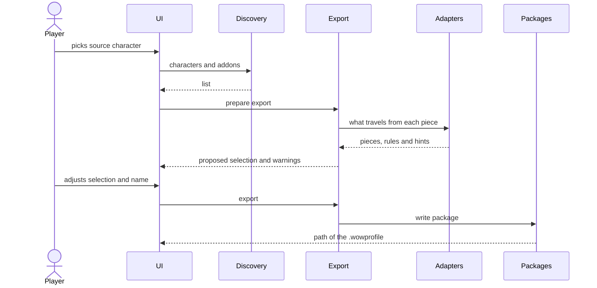
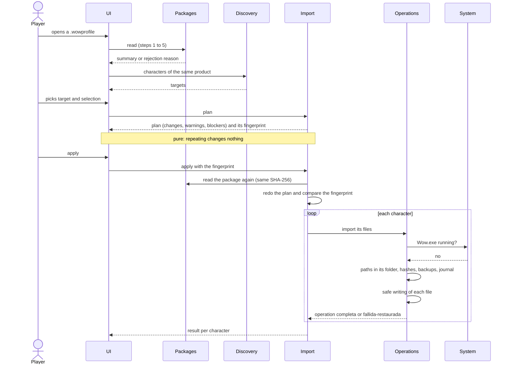

# Architecture

How work is split inside the app and who touches the disk. This is the starting design for Phase 3: module names are
design names, not crates or folders. What each flow does step by step is in [`flows.md`](flows.md); the concepts, in
[`data-model.md`](data-model.md).

## Pieces

- **UI**: React + TypeScript inside the Tauri 2 window. It shows and asks; it does not read or write files.
- **Core**: Rust. Everything that touches the disk, reads Lua or computes a plan.
- **Boundary**: the Tauri commands. The UI calls a command and gets data back (lists, a plan, a
  result). It never receives paths to write to and never sends file contents.

```mermaid
flowchart LR
    subgraph app["WoW Profile Manager (.exe)"]
        ui["UI<br/>React + TypeScript"]
        cmd{{"Tauri commands"}}
        subgraph nucleo["Core (Rust)"]
            det["Detection<br/>installations and versions"]
            desc["Discovery<br/>accounts, characters, addons"]
            ana["Analysis<br/>Lua as data (full_moon)"]
            ada["Adapters<br/>generic rules + catalog"]
            exp["Export"]
            pkg["Packages<br/>.wowprofile"]
            imp["Import<br/>plan, pure"]
            ope["Operations<br/>backup, writing, undo"]
            sis["System<br/>WoW process, language"]
            pref["Preferences<br/>manual folders, names"]
        end
    end
    wtf[("WTF and Interface<br/>of the installation")]
    datos[("App data<br/>folder")]
    fichero[(".wowprofile")]

    ui --> cmd
    cmd --> det & desc & exp & imp & ope & pref
    desc --> det
    det --> pref
    desc --> ana
    exp --> desc & ada & pkg
    ada --> ana
    imp --> pkg & desc & ada
    ope --> sis
    det -. reads .-> wtf
    desc -. reads .-> wtf
    ana -. reads .-> wtf
    pkg -. reads and writes .-> fichero
    ope == "only writer" ==> wtf
    ope -. backups and journal .-> datos
    pref -. reads and writes preferencias.json .-> datos
```

| module | does | touches the disk |
|---|---|---|
| Detection (`deteccion.rs`) | finds installations and versions (registry, Battle.net agent, chosen folder) | reads |
| Discovery (`descubrimiento.rs`) | accounts, characters, installed addons and their `.toc` | reads |
| Analysis (`lua.rs`) | reads and rewrites Lua tables without running them, with minimal changes | reads |
| Adapters (`adaptadores.rs`) | decides which piece of each addon travels: generic rules for any addon, plus the catalog of exceptions | no |
| Export (`exportacion.rs`) | assembles a character's pieces and their warnings | no (Packages writes it) |
| Packages (`paquetes.rs`) | reads a `.wowprofile` with the format checks; writes a new one | reads and writes only the `.wowprofile` |
| Import (`importacion.rs`) | computes the plan: changes, warnings, blockers | no |
| Operations (`operaciones.rs`) | runs a plan or a deletion: journal, backups, safe writing, restore, history | **only one that writes to `WTF`** |
| System (`sistema.rs`) | whether a `Wow.exe` is running (with `tasklist.exe`: the core forbids `unsafe`); Windows language | queries processes |
| Preferences (`preferencias.rs`) | manually added folders, custom names for installations and accounts, and the registry switch | reads and writes only `preferencias.json` in the app data folder |
| Update (`actualizacion.rs`) | looks up the latest GitHub release, checks the minisign signature with the public key shipped in the app and replaces the `.exe` (#3) | the **only one that goes online**, and only with the switch on; writes the new `.exe` to the data folder and deletes it |
| Diagnostics (`diagnostico.rs`) | sole logger of the `log` facade: session lines in memory, to the UI and, if turned on, to a bounded `.txt` (#60) | writes only to `registros/` in the app data folder, and only when on |

The **app data folder** is `wow-profile-manager-datos/`, next to the `.exe` (`portable.rs`, #3): preferences,
`operaciones/`, `registros/` and the WebView2 data (`webview/`). Nothing in `%APPDATA%`, `%LOCALAPPDATA%` or the Windows
registry. If it cannot be written to, the app says so with a native message and does not start.

Design criteria:
- The adapter catalog ships **inside the executable**: importing needs no network.
- Network: only Update, over HTTPS with the Windows TLS, and never with "Check for updates on startup" off
  nor in development. Only an `.exe` with the app's signature is installed; the private key is not in the repo.
- Detection and Discovery never write anything, not even caches, inside the installation.
- The folder picker is opened by the core (`tauri-plugin-dialog` from Rust): the UI asks to "Add folder" and has no permission to open dialogs or choose paths.
- `preferencias.json` is written atomically (temporary file and rename) and under a lock. If it cannot be parsed, the app carries on without it and does not overwrite it.
- The core decides on closing the window: while the Operations lock is held, it prevents closing and notifies the UI, which asks the user (`docs/flows.md`, "Closing with an operation in progress").

## Export



## Import



If the fingerprint differs (the disk or the package changed since the preview), nothing is written. If a character
fails, it is restored and the following ones are not applied (#63).

## Invariants

They can be checked in the code, and Phase 3 turns them into tests:

1. **Only Operations writes to `WTF`.** No other module receives an installation path with write
   permission.
2. **The UI never touches the disk.** Everything goes through the Tauri commands, which return data.
3. **Planning is pure.** With the same package, the same selection and the same disk read, the plan is the same, and
   computing it writes nothing.
4. **Lua is data.** Analysis reads and rewrites tables; nothing runs code from a `SavedVariables`.
5. **No network to import or export.** The only network request is the self-update, and it can be turned off.
