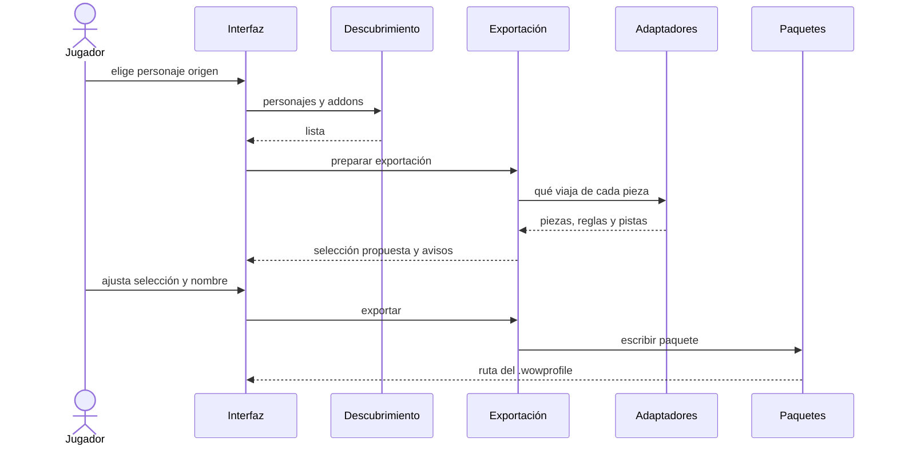
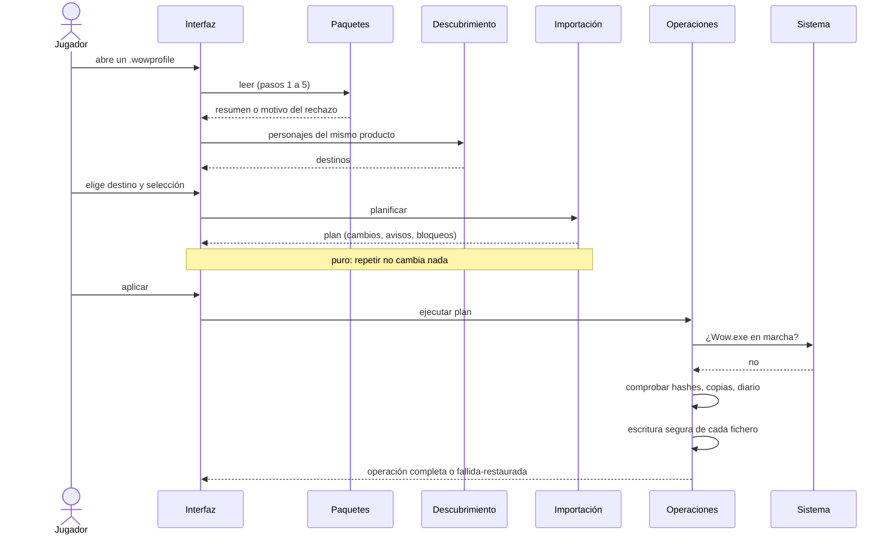

# Arquitectura

Cómo se reparte el trabajo dentro de la app y quién toca el disco. Es el diseño de partida de la Fase 3: los
nombres de los módulos son de diseño, no de crates ni de carpetas. Qué hace cada flujo paso a paso está en
[`flujos.md`](flujos.md); los conceptos, en [`modelo-de-datos.md`](modelo-de-datos.md).

## Piezas

- **Interfaz**: React + TypeScript dentro de la ventana de Tauri 2. Enseña y pregunta; no lee ni escribe ficheros.
- **Núcleo**: Rust. Todo lo que toca el disco, lee Lua o calcula un plan.
- **Frontera**: los comandos de Tauri. La interfaz llama a un comando y recibe datos (listas, un plan, un
  resultado). Nunca recibe rutas para escribir ni manda contenido de ficheros.

```mermaid
flowchart LR
    subgraph app["WoW Profile Manager (.exe)"]
        ui["Interfaz<br/>React + TypeScript"]
        cmd{{"Comandos de Tauri"}}
        subgraph nucleo["Núcleo (Rust)"]
            det["Detección<br/>instalaciones y versiones"]
            desc["Descubrimiento<br/>cuentas, personajes, addons"]
            ana["Análisis<br/>Lua como dato (full_moon)"]
            ada["Adaptadores<br/>reglas genéricas + catálogo"]
            exp["Exportación"]
            pkg["Paquetes<br/>.wowprofile"]
            imp["Importación<br/>planificar, puro"]
            ope["Operaciones<br/>backup, escritura, deshacer"]
            sis["Sistema<br/>proceso de WoW, idioma"]
            pref["Preferencias<br/>carpetas a mano, nombres"]
        end
    end
    wtf[("WTF e Interface<br/>de la instalación")]
    datos[("Carpeta de datos<br/>de la app")]
    fichero[(".wowprofile")]

    ui --> cmd
    cmd --> det & desc & exp & imp & ope & pref
    desc --> det
    det --> pref
    desc --> ana
    exp --> desc & ada & pkg
    ada --> ana
    imp --> pkg & desc & ada
    ope --> sis
    det -. lee .-> wtf
    desc -. lee .-> wtf
    ana -. lee .-> wtf
    pkg -. lee y escribe .-> fichero
    ope == "única escritura" ==> wtf
    ope -. copias y diario .-> datos
    pref -. lee y escribe preferencias.json .-> datos
```

| módulo | hace | toca el disco |
|---|---|---|
| Detección | encuentra instalaciones y versiones (registro, agente de Battle.net, carpeta elegida) | lee |
| Descubrimiento | cuentas, personajes, addons instalados y sus `.toc` | lee |
| Análisis | lee y reescribe tablas Lua sin ejecutarlas, con cambios mínimos | lee |
| Adaptadores | decide qué pieza de cada addon viaja: reglas genéricas para cualquier addon, más el catálogo de excepciones | no |
| Exportación | arma las piezas de un personaje y sus avisos | no (lo escribe Paquetes) |
| Paquetes | lee un `.wowprofile` con las comprobaciones del formato; escribe uno nuevo | lee y escribe solo el `.wowprofile` |
| Importación | calcula el plan: cambios, avisos, bloqueos | no |
| Operaciones | ejecuta un plan o una eliminación: diario, copias, escritura segura, restauración, historial | **única que escribe en `WTF`** |
| Sistema | si hay un `Wow.exe` en marcha (con `tasklist.exe`: el núcleo prohíbe `unsafe`); idioma de Windows | consulta procesos |
| Preferencias | carpetas añadidas a mano y nombres propios de instalaciones y cuentas | lee y escribe solo `preferencias.json` en la carpeta de datos de la app |

Criterios de diseño (míos):
- El catálogo de adaptadores va **dentro del ejecutable**: importar no necesita red.
- Detección y Descubrimiento no escriben nada nunca, ni cachés, dentro de la instalación.
- El selector de carpetas lo abre el núcleo (`tauri-plugin-dialog` desde Rust): la interfaz pide «añadir carpeta» y no tiene permiso para abrir diálogos ni para elegir rutas.
- `preferencias.json` se escribe de forma atómica (temporal y renombrar) y bajo un cerrojo. Si no se entiende, la app sigue sin él y no lo sobrescribe.

## Exportar



## Importar



## Invariantes

Se pueden comprobar en el código, y la Fase 3 los convierte en tests:

1. **Solo Operaciones escribe en `WTF`.** Ningún otro módulo recibe una ruta de la instalación con permiso de
   escritura.
2. **La interfaz nunca toca el disco.** Todo pasa por los comandos de Tauri, que devuelven datos.
3. **Planificar es puro.** Con el mismo paquete, la misma selección y el mismo disco leído, el plan es el mismo, y
   calcularlo no escribe nada.
4. **Lua es dato.** Análisis lee y reescribe tablas; nada ejecuta código de un `SavedVariables`.
5. **Sin red para importar o exportar.** La única petición de red es la autoactualización, y se puede desactivar.
