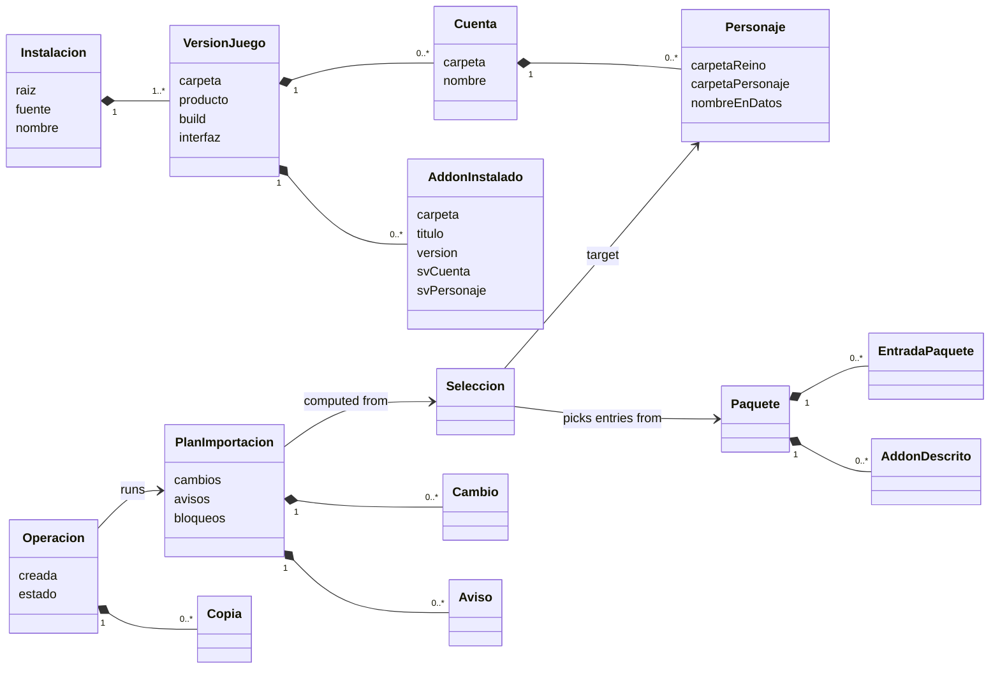

# Data model

The concepts WoW Profile Manager works with, how they are identified and the rules that no part of the code may
break. It is the basis for the app's types. The package format is in
[`wowprofile-format.md`](wowprofile-format.md) and what was measured in
[`wow-forever-compatibility.md`](wow-forever-compatibility.md).

Marks: **[V]** verified, **[I]** inference, **[H]** hypothesis.

## Three zones

| zone | what it contains | effects |
|---|---|---|
| **What is on disk** | installation, game version, account, character, installed addon | read only |
| **What travels** | package and its entries | none: it is a value |
| **What is decided and done** | selection, import plan, operation | only the operation writes |



## What is on disk

### Installation

A WoW root folder on this computer.

| field | source |
|---|---|
| `raiz` | absolute path. **Never leaves the computer** (it does not go into the package) |
| `fuente` | `registro`, `battlenet` or `manual` |
| `nombre` | custom name set by the user ("Home"); without it, "Installation N" next to the path |
| `versiones` | the subfolders with a game inside |

**Detection** (`deteccion.rs`), in this order. Results are merged and duplicate paths removed (ignoring case,
trailing separator and `/` vs `\`), and the first source wins:

1. **Windows registry**: `Uninstall\World of Warcraft`, value `InstallLocation` [V].
2. **Battle.net agent**: `C:\ProgramData\Battle.net\Agent\product.db` lists each root with its subfolders
   and versions [V]. It is an undocumented binary format: it is used as a **hint** and a path is never trusted
   without checking it on disk. If it does not exist or cannot be parsed, detection goes on without it and with no visible error.
   Measured: it is **protobuf** with no published schema [V]. Field `1`, repeated, is an installed product; inside, `2` is
   the code (`agent`, `bna`, `wow`, `wowf`…) and `3` its install settings, with `1` the root written with `/`
   (`C:/Juegos/World of Warcraft`), `2` the region (`eu`) and `13` the subfolder (`_retail_`, `_forever_`) [V]. Only
   products whose code starts with `wow` are read; `wow` and `wowf` share a root [V].
3. **Manual**: the user picks a folder. It is always available, even if the other sources find
   nothing. It is remembered across launches; if it stops existing, it is listed as "Not found" until removed.

Manual folders and custom names live in `preferencias.json`, in the app data folder and
**never inside an installation**. The key of an installation is its normalized root (lowercase, no
trailing separator); the key of an account, root + version folder + account folder. Removing a manual folder
also deletes its names.

Rule: a folder is only an installation if it has `.build.info` at its root [V].

### Game version

A subfolder of the installation (`_retail_`, `_forever_`…).

| field | source |
|---|---|
| `carpeta` | name of the subfolder |
| `producto` | `<carpeta>/.flavor.info`: `wow` in `_retail_`, `wowf` in `_forever_` [V] |
| `build` | root `.build.info`, `Version` column of the row whose `Product` matches [V] |
| `interfaz` | `WTF/Config.wtf`, `SET engineSurveyPatch` (`16001` in Forever, `120105` in Retail) [V] |

- The app works with `wowf` and `wow`. Other products are listed as "not supported".
- If `Config.wtf` has no `engineSurveyPatch`, the version cannot be exported yet. [H] Opening the game once is
  enough, because the client writes it.

### Account

A folder in `WTF/Account/`.

- Identity: (installation, version, folder).
- `nombre`: custom name set by the user ("Main"); without it, "Account N" from the folder's `#N`.
- Only folders shaped `<number>#<number>` count [V]. The rest (for example a copy `…#1.back`, or
  `SavedVariables`) are ignored and their count is shown.
- It has its `SavedVariables/` and its account files (`macros-cache.txt`, `bindings-cache.wtf`…).

### Character

A folder `WTF/Account/<cuenta>/<reino>/<personaje>/`.

| field | what it is |
|---|---|
| `carpetaReino`, `carpetaPersonaje` | **identity**, together with the installation, the version and the account |
| `nombreEnDatos` | how it appears in the `SavedVariables`; **it is resolved**, and may stay unresolved |

**The folder name is not the character name** [V]. In the same realm there can be a folder with `ø`
in the name and another with the name in ASCII and a hexadecimal suffix (`…8D31D`). Therefore:

- The identity is the folder, never the name. Two characters with the same folder in two installations are
  different characters: the UI always shows which installation each one belongs to.
- `nombreEnDatos` is resolved in this order:
  1. From the data: a character key that exists in the account's `SavedVariables` (`profileKeys` and
     similar) and matches the folder.
  2. From the folder. In Forever, `Nombre-Apellido` → `"Nombre Apellido"` [V]. In Retail, `"Nombre - Reino"`.
  3. If nothing fits, the user is asked. **It is never made up.**
- The character keys of rule 1 are those of each `profileKeys` table with `profiles` next to it (AceDB), in
  the `.lua` files of `<cuenta>/SavedVariables`. In Forever the key has no realm (`"Goldberg Joestar"`) [V]; in
  Retail it does (`"Gøldberg - Sanguino"`) [V]. The match is exact: the data confirm the folder's candidate,
  they do not look for similar names. The result says where it comes from: `datos` or `carpeta`.
- A folder with a suffix (`Goldber8D31D`, `Bison2D457`) carries the last 5 characters of the character's GUID
  (`character-list-order.txt`: `1379-0928D31D`) [V]. WoW names have no digits [I], so a
  folder with digits yields no name: it stays unresolved.
- The internal realm name in Forever (`CAMWOW EU5 Realm 4 PvP`) does not appear in any path [V]. If an
  adapter needs it, it comes from the target's own data.

**Realms from another version.** Inside one version's `WTF` there can be realm folders copied by hand from the
other [V: measured once]. Retail and Forever do not mix, so those folders are not listed; their ignored count is
shown. Folders in `WTF/Account` without an account shape and those in `Interface/AddOns` without a loadable `.toc`
appear in the Diagnostics tab, one by one and with their reason (#60).
- In Forever, characters are in numeric realm folders (`93`) [V in one installation; H as a general
  rule]. In Retail, the realm folder is the realm name [V].
- Since the Forever rule is [H], the count of ignored folders is always visible: if the rule is
  wrong for some installation, it shows.

**Valid target.** The target character must have logged into the game at least once, because the client
creates its folder on login [I]. If it does not exist, the app explains it; it does not create character folders.

### Installed addon

A folder in `Interface/AddOns/` with its `.toc`.

| field | source |
|---|---|
| `carpeta` | identity, together with the version |
| `titulo`, `version`, `enlace`, `dependencias` | `.toc`. Of 62 addons measured: `Version` in 58, link in 27 and dependencies in 34 [V] |
| `svCuenta`, `svPersonaje` | `## SavedVariables` and `## SavedVariablesPerCharacter` from the `.toc` |

- The game only loads a `.toc` named after its folder: a folder `X-bak` with `X.toc` is not loaded [V].
  The game-flavor one is looked up first and then the general one: Forever `<carpeta>_Camelot.toc` [V] (some addons
  ship only that one) and Retail `<carpeta>_Mainline.toc` [I]; otherwise, `<carpeta>.toc`. Folders without a
  loadable `.toc` are counted, not listed.
- From the `.toc` the app reads: `Title` (without `|c…|r` color codes), `Version`, `X-Website` as the link, `Dependencies`
  and `RequiredDeps` as dependencies (`OptionalDeps` is not one), `SavedVariables` and `SavedVariablesPerCharacter`.
  Keys are case-insensitive; BOM and CRLF do not matter [V: 226 `.toc` files measured].
- The `.toc` is a hint: what counts is which files are on disk [V].
- A `SavedVariables` is AceDB if its table has `profileKeys` and `profiles` [I]. This is decided from the data, not
  from the library the addon ships.
- Addons listed in `AddOns.txt` but not installed are ignored on export [V].

## What travels

### Package and entries

The manifest and the pieces of [`wowprofile-format.md`](wowprofile-format.md). In memory it is an immutable
value: it is read, fully validated (hashes included) and from then on it does not change.

Export is the reverse path, and it does not write anything to `WTF` either:
`exportar(personaje origen, selección de exportación, disco leído) → Paquete`.

## What is decided and done

### Selection

What the user picks when importing:

- The target character.
- Which entries are applied. For each addon, "enabled" and "settings" separately.
- The answers to whatever needs a decision:
  - If there is already an AceDB profile with that name: rename or overwrite.
  - The entries that affect the whole account: accepted or not.

### Import plan

```
planificar(paquete, selección, disco leído) → Plan
```

**It is pure**: it writes nothing and, with the same input, always gives the same plan. The preview shows the plan
as is, so what you see is exactly what will be done.

| part | what it holds |
|---|---|
| `cambios` | one per file: real path, action (`crear`, `sobrescribir` or `fusionar` a profile), hash of the file read (or "did not exist"), new content and its hash, source entry, and whether it affects the whole account |
| `avisos` | do not prevent applying: different class, different interface within the same game version, missing addon, unknown adapter |
| `bloqueos` | prevent applying: WoW open, invalid package, nonexistent target |

Rules:
- Every path of a change is **inside** the target character's folder or its account's.
- No change touches another character, except those marked "affects the whole account" that the user accepted.
- A plan with blockers is not run.

### Operation

```
ejecutar(plan) → Operación
```

It is the only thing that writes:

1. It checks that WoW is closed and that **each file still has the hash the plan read**. If any changed
   (for example, the game was opened and closed in between), it writes nothing and asks to plan again.
2. It makes the **backup** of everything it will touch, before the first write.
3. It writes each file to a temporary file and renames it over the original (atomic write).
4. If something fails, it restores the whole backup and records the operation as failed.

| field | what it is |
|---|---|
| `creada`, `destino`, `paquete` | when, where and what was imported (profile name and file hash) |
| `cambios` | for each file touched: `antes` (its backup and its hash, or "did not exist") and `despues` |
| `estado` | `completa`, `deshecha`, `fallida-restaurada`… (full list in [`flows.md`](flows.md#states)) |

**Undo** restores the backup of an operation, and is itself another operation. First it compares the files with the
hash the operation left. Usually they do not match, because the game rewrites them on exit: the app
explains it and lets the user choose.

Operations and their backups are stored as files, one folder per operation, inside the app data
folder. The details, the write order and the history are in [`flows.md`](flows.md).
