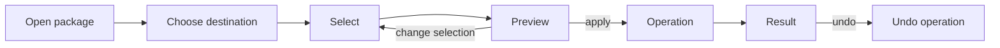
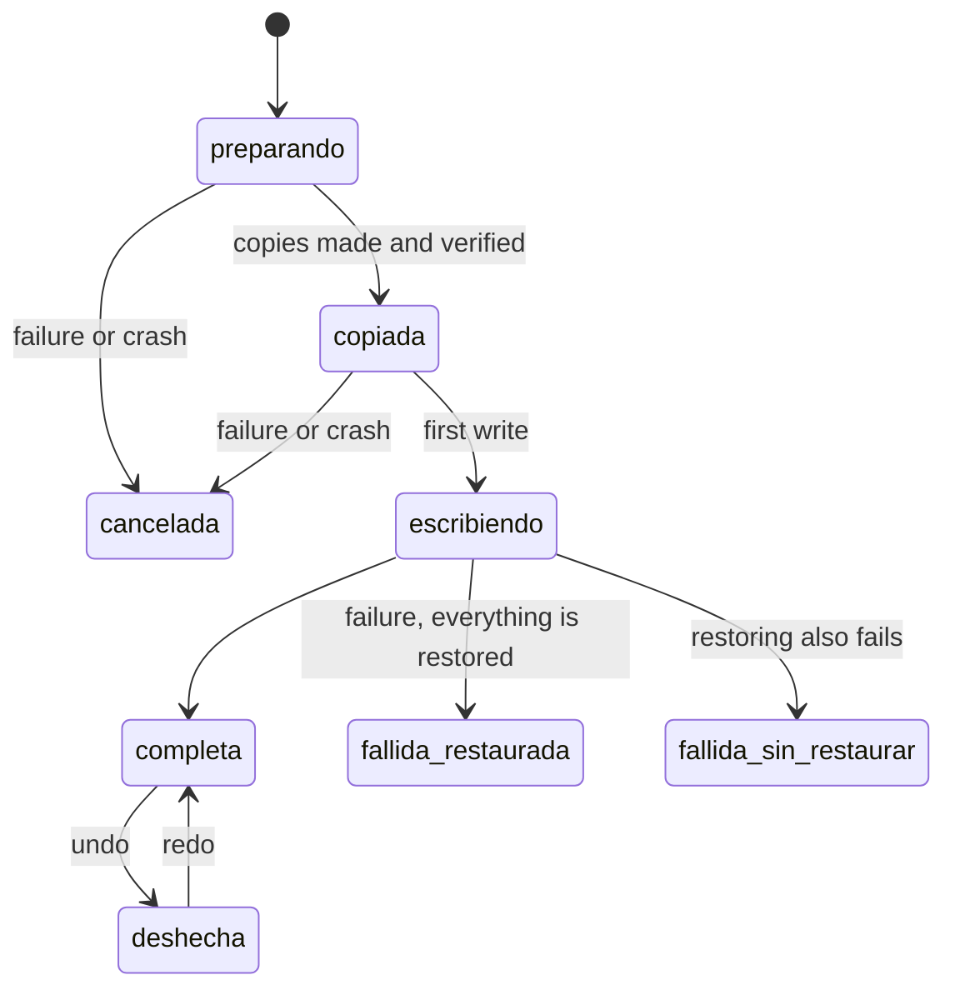

# Export and import flows, backups and history

What the player does at each step, what the app decides for them and what can stop it. The concepts (plan, operation,
selection) are in [`data-model.md`](data-model.md); the package, in [`wowprofile-format.md`](wowprofile-format.md);
what travels from each addon, in [`adapters.md`](adapters.md).

Marks: **[V]** verified, **[I]** inference, **[H]** hypothesis.

## Principles

- **Only the operation writes to `WTF`.** Everything before it (reading, selecting, planning, preview) can be
  cancelled without leaving a trace.
- **What you see is what gets done.** The preview shows the plan as is; applying runs that plan and no
  other.
- **No backup, no write**, and the backup is saved before the first file is touched.
- **No writes while WoW is open.** Any running `Wow.exe` blocks apply and undo. Forever and Retail use the same
  executable name [V], so the app does not try to tell the version apart: it always blocks.

## Export

Does not write to `WTF` and does not go into the history.

1. **Source.** The player picks the game version, account and character.
2. **Read.** The app reads the files of the character and of its account, and decides what to offer from each addon
   using the order in [`adapters.md`](adapters.md#decision-order).
   - Exporting is allowed with WoW open, with a warning that changes made in the current session are not on disk
     until the player logs out of the character or reloads the UI (`/reload`) [I].
   - A file that cannot be read as Lua (for example, because the game was writing it) is marked as not exportable,
     with the reason. The rest goes on.
3. **Selection.** By category and, in `config-addon` (addon settings), by addon. Checked by default:

   | what | default |
   |---|---|
   | macros, key bindings, click bindings, options, chat, windows, Edit Mode, enabled addons, raid frames | checked |
   | addon piece that comes from an adapter rule or from an AceDB variable | checked |
   | addon piece that comes from a generic rule (account, per character, or account with characters) | **unchecked**, with the warning of its rule and any hints found ([details](adapters.md#decision-order)) |
   | addon with `noExportar` (do not export) or no data | not shown |

   The decision is **per piece, not per addon**: the same addon can have an AceDB variable, which travels checked,
   and another file that falls under a generic rule, which travels unchecked.

   "Select all" checks all generic pieces of a type at once, **except those with hints** of other players: those
   are checked one by one, seeing their warning.

   A generic piece travels as is, without replacing placeholders: it can carry the source character's name and
   other players' data. The warning says so, because the one exposed by checking it is the person exporting.

4. **Profile data.** Name (required) and description.
5. **Summary.** What will travel, the size and the warnings. It always includes a note: **the contents of the
   action bar buttons do not travel** (the server stores them [V]). The bar layout, each button's key binding
   and the macros do travel.
   - If a piece already contains `@@WOWPROFILE:`, it is dropped from the package and the app says which one.
   - Blocks if the format limits are exceeded (256 pieces, 32 MiB per piece, 128 MiB in total).
6. **Save.** Save dialog with `<name>.wowprofile` proposed. It is written to a temporary file and renamed:
   a failure does not leave a half-written `.wowprofile`.

## Import



### 1. Open the package

Open dialog or drag the file in. Steps 1 to 5 of
["Reading a package safely"](wowprofile-format.md#reading-a-package-safely) are applied; step 6 (translating each
`destino` to a real path) needs the destination character and is done when it is chosen. If any step fails, the app
says which one and stops: there are no "half-valid" packages.

The summary is shown: name, description, date, game version and source class (if present), and which
categories and addons it carries.

### 2. Choose the destination

One or more characters, **only of the package's game version** (`origen.producto`) and **from a single
installation**, even if they belong to different accounts (#63). Retail and Forever are not mixed: a Forever package
only offers Forever characters, and a Retail one, Retail characters.

With several characters, applying runs **one operation per character**, one after another: each one gets its own line
in the history and is undone separately. If one fails, that one is restored, the following ones are not applied and the
previous ones stay applied; the result reports it character by character.

- If this computer has no installation of that product, the app says which version the package is for and offers
  no destinations. It is not a package error.
- If the version is the same but the interface is not (`origen.interfaz` different from the destination's, for
  example after a game update), it is offered with a warning.
- If the source class is known and does not match the destination's, warning. It never blocks.
- If the character has no folder, the app explains that the player has to log in once with it [I]. It does not
  create character folders.
- Once the destination is chosen, each logical `destino` is translated to its real path and checked to fall inside
  the folder of the character or of its account (step 6 of the format).

### 3. Select

The package entries, by category and, in `config-addon`, by addon. For each addon, "enabled" and
"settings" separately.

| case | default |
|---|---|
| normal entry | checked |
| `config-addon` of type `fichero` (file; it came from a generic rule) | **unchecked**, with a warning: it can carry state or other players' data. The package is not signed, so the app does not trust what the exporter chose |
| unknown category or type (package from a newer minor version) | unchecked, with a warning |
| adapter the app does not know, from another addon or from a **newer** version than its own; piece that is not data only | not imported, with its reason (an adapter from an older version is: the app's rule applies it) |
| destination addon outside the `versionesAddon` range of a rule with `entera` or `excluir` | like the others, with the warning in the preview: the selection belongs to the package and does not know what each destination has |
| addon not installed at the destination | as if it were installed (checked, or unchecked if of type `fichero`), with the "addon missing" warning in the preview [V: the client keeps the `SavedVariables` of an uninstalled addon; [H] it loads it when installed] |
| entry that affects the whole destination account: those going to `cuenta/` (general macros, account options), account generics and adapter rules with `ambito: cuenta` not limited to `soloPersonaje` | **undecided**, once per destination account: the player accepts or removes it in that account before applying. With several characters from the same account, it is written in the first one's operation and the others show "Unchanged" |
| AceDB profile whose name already exists at the destination and is different (also a module's) | **undecided** in the preview, once per account: rename (proposes the first free `<name> (n)`) or overwrite. If it is identical, there is nothing to decide |

Overwriting an existing AceDB profile changes the settings of **all** the destination characters that use it
(those pointing to it in `profileKeys`). If there is any besides the destination, the option is shown with their
names and counts as "affects the whole account". Renaming never touches another character, which is why it is the
proposed option.

### 4. Preview

It is the import plan. Five groups, as in the original brief:

| group | contents | details |
|---|---|---|
| **New** | files that did not exist | path and size |
| **Modified** | files that are overwritten or into which a profile is merged | macros and key bindings: item by item (macro added, changed or removed; key binding changed). Lua: which profile or which keys change. Those affecting the whole account are flagged separately |
| **Unchanged** | entries whose result is identical to what is already there | not written |
| **Conflicts** | what is still undecided | cannot apply until resolved |
| **Incompatible** | entries that cannot be applied, with the reason | not written |

With several destinations, the groups are per character. Macros are compared **by id** (`VER 3 <id>`), not by name:
the name can be blank and repeated [V: the 14 macros of a measured character are named `" "`]; without a name, the
first line of the body is shown. Key bindings, binding by binding.

Below, the warnings and the blockers (WoW open, missing destination). "Apply" is only enabled with no blockers and
no conflicts. Going back to the selection recalculates the plan.

The plan stores, for each file, its fingerprint (SHA-256 as it was, or "did not exist") and the exact bytes that will
be written: applying writes those bytes and no others, and writes nothing if the disk no longer matches the plan.

### How each category is written

For the file categories (#63):

| category | how |
|---|---|
| `opciones` (options) | **merge** by `SET` key, case-insensitive: the package keys change and the rest of the destination is kept byte for byte. Keys on the list that does not travel ([format](wowprofile-format.md#categories)) are also discarded on import and reported |
| `addons-activos` (enabled addons) | **merge** by folder: the value of those the package carries changes, keeping how the destination writes the folder, and those the destination does not have are appended at the end. Enabled addons that are not installed are written anyway, with the "addon missing" warning |
| `macros` | **overwrites** the file, with macro-by-macro details |
| `teclas`, `teclas-clic`, `chat`, `ventanas`, `marcos-banda` (key bindings, click bindings, chat, windows, raid frames) | **overwrites** the file |

For addon settings (#72):

| type | how |
|---|---|
| `perfil-acedb` (AceDB profile) | **merge**: the profile goes to `profiles` and each module's to `namespaces.<module>.profiles`, and only the destination character's entry in `profileKeys` points to it. The other entries, including other characters', stay byte for byte. If the variable or the file does not exist, it is created |
| `adaptador` (adapter) | **merge by key** with the rule from the app's catalog ([adapters](adapters.md#how-it-is-applied-on-the-target)) |
| account generic (`fichero` or `fichero-filtrado`, filtered file) | each variable in the piece replaces the destination's; the other variables in the file stay (those that travel as a profile, for example). A piece with an AceDB base is not imported, and one at the destination is not touched |
| character generic (`fichero`) | **overwrites** the file |

- Entries going to the same file are applied in package order and the file is written only once.
- An account file with several destinations from that account carries everything for all of them (each with its
  `profileKeys`) and is written in the first one's operation; the others show "Unchanged". Undoing the first one
  undoes it for all.
- A character with no name in the data does not receive AceDB profiles or rules with `soloPersonaje`: it is unknown
  under which key the addon stores it. A destination file that cannot be parsed as Lua is not touched. Both show in the
  preview as "not applied to this character".

In all of them, `cache.md5` is not touched: with WoW closed, the client adopts the local file on login [V: Phase 1].

### 5. Apply

It is confirmed with what will be written to each character. Before writing, the app reads the `.wowprofile` again
(it must have the same SHA-256 as when it was opened), rebuilds the plan and compares it with the one shown (its
**fingerprint**: path, before hash and after hash of each file written). If anything changed, it writes nothing and
shows the preview again.

Then, one operation per character (see [Operations on disk](#operations-on-disk)), one after another. Each one only
includes the "new" or "modified" files; a character with nothing to write creates no operation. While it runs, the
app does not let the window close without a warning (see
[Closing with an operation in progress](#closing-with-an-operation-in-progress)).

### 6. Result

- **Complete**: what was written and the next step, logging in with that character and checking it. It reminds the
  player that abilities on the buttons are placed by the player: the profile brings the layout and the key bindings,
  not the contents. "Undo" button.
- **Failed and restored**: what failed. `WTF` is as it was.
- **Failed, not restored**: what failed, which files were left broken and where the copies are to restore them by
  hand. It should never happen, but if it does, everything is reported.

## Operations on disk

Each import, each undo and each deletion of a character's folder is an **operation**: a folder inside the app's data
folder.

```
<data folder>/operaciones/
  20261117-213045-a1b2c3d4/
    operacion.json        journal and metadata (operacion.schema.json)
    copias/
      0                   previous contents of the first file that existed
      1
      …
```

- Copies are named by number. The real path of each one is in `operacion.json`; it is never inferred from the name.
- No database. The history is the list of folders. If the app stops working, anyone can restore by hand by copying
  each `copias/<n>` to its `ruta`.
- Everything is written with [safe writing](#safe-writing), `operacion.json` included.

### `operacion.json`

Schema: [`operacion.schema.json`](operacion.schema.json).

| field | what it is |
|---|---|
| `esquema` | `1` |
| `id` | `AAAAMMDD-HHMMSS-<8 hex>` (YYYYMMDD), the same as the folder. The top 10 bits of the 8 hex digits are the millisecond, to order two operations in the same second; the rest is random |
| `tipo` | `importacion` (import), `deshacer` (undo) or `eliminacion` (deletion) (see [Deleting a character's folder](#deleting-a-characters-folder)) |
| `creada`, `terminada` | RFC 3339 in UTC; `terminada` as soon as it reaches a final state |
| `estado` | see [States](#states) |
| `paquete` | profile name and SHA-256 of the `.wowprofile` file (only in `importacion`) |
| `deshace` | `id` of the operation it undoes (only in `deshacer`) |
| `deshechaPor` | `id` of the operation that undid it (only with `estado: deshecha`, undone) |
| `destino` | root of the game version, product, account, realm and character folders, and the resolved name if it was resolved |
| `cambios[]` | one per file: `ruta`, `accion`, `deCuenta`, source `entrada` (only in `importacion`), `antes` (did not exist, or hash, size and copy) and `despues` (hash and size, or does not exist) |
| `error` | what failed (required in the failed states) |

Actions:

| `accion` | in | what it does |
|---|---|---|
| `crear` (create) | `importacion` | writes a file that did not exist |
| `sobrescribir` (overwrite) | `importacion` | replaces a whole file |
| `fusionar` (merge) | `importacion` | changes only some keys or a profile inside the file |
| `restaurar` (restore) | `deshacer` | returns a file to its previous contents |
| `borrar` (delete) | `deshacer`, `eliminacion` | removes a file: the one the import had created, or one from the character's folder |

`ruta` is relative to the version root and always starts with `WTF/Account/`. The schema only checks the
shape. Before writing, the app also checks that each path falls inside the destination character's folder
(or its account's if `deCuenta`), with no links or junctions along the way, and rejects names that Windows does not
treat literally: those with forbidden characters (`:` would open an NTFS alternate data stream), those ending in a dot
or a space, and device names (`CON`, `NUL`…).

The root and the account folders **never leave the computer**: `operacion.json` is not shared or exported.

### States



In the file, states are written with a hyphen: `fallida-restaurada` (failed, restored), `fallida-sin-restaurar`
(failed, not restored). The final states are `completa` (complete), `deshecha` (undone), `cancelada` (cancelled),
`fallida-restaurada` and `fallida-sin-restaurar`. The others are `preparando` (preparing), `copiada` (copied) and
`escribiendo` (writing).

### Safe writing

Every file the app writes (those in `WTF`, the copies and `operacion.json` itself) is written to a temporary file
in the same folder, flushed to disk and renamed over the destination. A power cut leaves the old file or the new
one, never a half-written one [I: what a rename within the same NTFS volume guarantees; untested].

### Write order

1. Check that no `Wow.exe` is running and that each file in the plan still has the hash the plan read.
   If any changed, nothing is created and the app asks to plan again.
2. Create the folder with `estado: preparando` and all `cambios` with their `antes` and `despues`.
3. Copy each file that existed to `copias/<n>`, read the copy back and check that its hash is the plan's
   `antes.sha256`. If it is not (the file changed in between), `cancelada` and plan again.
4. `estado: copiada`. Up to here `WTF` has not been touched.
5. `estado: escribiendo`. Write each file (or, for a `borrar`, remove it).
6. `estado: completa` and `terminada`.

If something fails in step 5, it is restored (see below) and moves to `fallida-restaurada`.

**Restoring** an operation means, for each file already touched: check that its copy still has the hash
`antes.sha256`, write it with safe writing and read the result back. Files that did not exist are deleted. If a copy
does not match or a write fails, the operation ends in `fallida-sin-restaurar` and the app says which files were left
broken and where the usable copies are.

### On startup

The app walks `operaciones/` looking for operations that are not in a final state:

| state found | what it means | what the app does |
|---|---|---|
| `preparando`, `copiada` | it stopped before touching `WTF` | marks it `cancelada` and says so |
| `escribiendo` | it stopped halfway: `WTF` may be half-written | an `importacion` is not touched: the app explains it and offers to restore it from the history (if restored, `fallida-restaurada`). While it stays like that, no other operation is created: another write could change its files and restoring it could no longer return them. An `eliminacion` or a `deshacer` restores itself (see below) |
| `operacion.json` unreadable | it is unknown where it stopped | warns that `WTF` **may** be half-written, shows the copies folder and deletes nothing |

Restoring on startup requires the same as applying: no running `Wow.exe`. If the game is open, on exit it
would rewrite the files over the restore.

Also, if a `deshacer` operation is `completa` and the one it undoes is not `deshecha`, the app marks it `deshecha`:
the interruption happened between the two steps of the undo.

### Closing with an operation in progress

Every write to `WTF` (delete, undo, restore, import and recovery on startup) is done holding the operations
lock. If the window is asked to close while someone holds it, the core prevents closing and
the app asks: "Wait" keeps it open and "Close anyway" closes it. Whatever is left interrupted is handled on the next
startup, as if the power had gone out (table above). Outside an operation, the window closes without asking.

Saving preferences and exporting a `.wowprofile` do not block closing: they are written atomically (see
[Safe writing](#safe-writing)) and an interruption leaves the old file or the new one.

Closing the app from Task Manager or a power outage cannot be intercepted: recovery on startup covers them
too.

## Deleting a character's folder

To clean up the folders left behind by characters deleted in the game (#49). It is an operation of type
`eliminacion` with one `borrar` change per file in the folder, and it follows the same [write order](#write-order):
first the verified copies, then the removal. When it finishes, the folders left empty are also removed.

- **What is requested**: the interface sends the installation, version, account, realm and character folder. The
  core rediscovers that account and only goes on if the character is in the list; it does not receive paths.
- **Confirmation**: name, realm, account, installation, path, number of files and size, and this warning.
- **If the character still exists**, the game recreates the folder when logging in with it [V: measured on
  2026-11-18]. Macros, Edit Mode and text-to-speech come back from the server; addon settings go back to their
  defaults, `AddOns.txt` is rebuilt with all addons enabled and `bindings-cache.wtf` does not come back. Deleting does
  not leave an existing character "clean": it resets its addons.
- **It does not touch** the character's keys in account `SavedVariables` (for example, AceDB's `profileKeys`).
- **On startup**, an `eliminacion` interrupted in `escribiendo` restores itself if no `Wow.exe` is running
  (with the game open, it waits for the next startup). Restoring it only returns files from verified copies to
  a folder the app emptied, without overwriting anything that exists. So nothing of the player's can be lost.

A deletion is undone from the [history](#history) (#54). If the app is not available, also by hand: copy each
`copias/<n>` to its `ruta`.

## Undo

Undo returns the files of a `completa` operation to how they were before.

1. **Newest to oldest.** If a later `completa` operation depends on this one, this one cannot be undone until that
   one is undone, and the app says which. It depends on it if it touched any of the same files or, when this one
   added Edit Mode layouts to the account, if it changed the layout used by a character of that account: the character
   points to the layout by its position, and removing it would leave it pointing to one that does not exist or to
   another one (#85). This way a more recent import is never silently overwritten.
2. **Same game.** The app checks that the version root exists and that its product (`.flavor.info`) is the
   `destino`'s. If not (installation moved, deleted or reinstalled with another version), nothing is written and the
   app says where the copies are.
3. For each change, the current hash is compared with the operation's `despues`. **Normally they do not
   match**: the player logs in to check the import and, on logout, the client rewrites the
   `SavedVariables` [V: measured in Phase 1]. It is not an error: the app shows which files have changed since the
   import and warns that **whatever the game saved in them since then is lost** (for example, that session's
   progress in that addon).
4. `deCuenta` files are flagged separately: restoring them returns that addon's settings to their previous state for
   **all** the characters of the account.
5. If the player confirms, a `deshacer` operation is created with the same write order: first it copies the
   current state and then it restores. When it finishes, the original moves to `deshecha`, with `deshechaPor`.

**Undoing an undo** ("redo" in the diagram) leaves the files as they were after the import again. The `deshacer`
moves to `deshecha` and the original import goes back to `completa` (without `deshechaPor`), so it can be undone again.

**Undoing a deletion** (#54) leaves the character's folder exactly as it was: each file that is not as before today
is returned from its copy, and those present now that were not there before (the game recreated the folder)
are removed; all with a prior copy in the `deshacer`. Those already as before are not touched. The plan shown carries
a fingerprint (SHA-256 of each affected file as it is): if the disk no longer matches the plan on confirmation,
nothing is written and the player is asked to review it again. A `deshacer` does not count as a "later operation" in
step 1: it only returned a previous state, and what would be overwritten shows in the plan. On startup, a `deshacer`
interrupted in `escribiendo` restores itself, like a deletion: restoring never overwrites anything the operation itself
did not write. "Redoing" a deletion (undoing its `deshacer`) is not offered yet: the copy of what was overwritten stays
in the `deshacer`.

**Undoing an import** (#63) only touches the files it wrote: those it created are removed (if still there) and
the others come back from their copy. No other file of the character is touched. Since a later import on another
character of the same account may have written the same account file, it counts as a later operation (step 1).

The MVP restores each file whole. Removing only the imported profile from an account file, without touching the rest,
is left for later.

## History

A list of operations, newest to oldest: date, type, destination character, profile, state and
size of its copies. At the top, the total space used.

- **Nothing is deleted automatically.** A single account file can weigh 9.5 MB [V: the largest `SavedVariables` of a
  measured account], and an import that merges into several takes up their sum. The player decides when to free
  space.
- **Deleting** an operation deletes its folder and with it the ability to undo it. The confirmation says so.
  - An operation in a non-final state cannot be deleted.
  - A `fallida-sin-restaurar` can only be deleted after confirming that the player already restored by hand: its
    copies may be all that is left of the previous state.
  - If an operation referenced by a `deshacer` is deleted, that other one shows "operation deleted".
- **Open the folder** of an operation in File Explorer, to restore by hand if needed.

## Diagnostic log

The **Diagnostics** tab shows live what the app is doing in the session (#60). It is always in the bar,
even when detection fails, which is when it is needed most. Each line carries local time with its offset, level
(`ERROR`, `WARN`, `INFO`), module and message:

- **Detection:** how many roots each source yields; each root with its source and its result (installation, duplicate,
  no `.build.info`, not found); each version with its product and its counts; and each skipped folder, with its path
  and its reason (from `WTF/Account`, not shaped like an account; from `Interface/AddOns`, no `.toc` the game loads).
- **Commands:** those that write log whether they finished successfully; any command that fails logs its error code
  and its data.
- **Operations:** each step saved to `operacion.json` (id, type, state, number of changes and error) and what
  recovery on startup did.

The last 1,000 lines of the session are kept in memory, whether or not there is a log on disk. Only the app's lines
are included: those from Tauri and its libraries are not.

**Save the log to a .txt file** is off by default. When on, each line is appended to
`registros/diagnostico.txt` in the app's data folder; past 1 MiB, that file becomes
`diagnostico.1.txt` (overwriting the previous one) and a new one starts, so the log takes no more than about 2 MiB.
When off, the app creates and writes nothing in that folder; whatever was already there stays. A failure writing the
log does not stop anything.

**Privacy.** The log does not leave the computer. It carries folder paths of the computer (which may include the
Windows user name) and the account folder names; the tab warns about it, so that whoever shares it when asking
for help knows what they are sharing.
