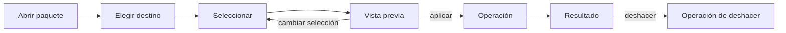
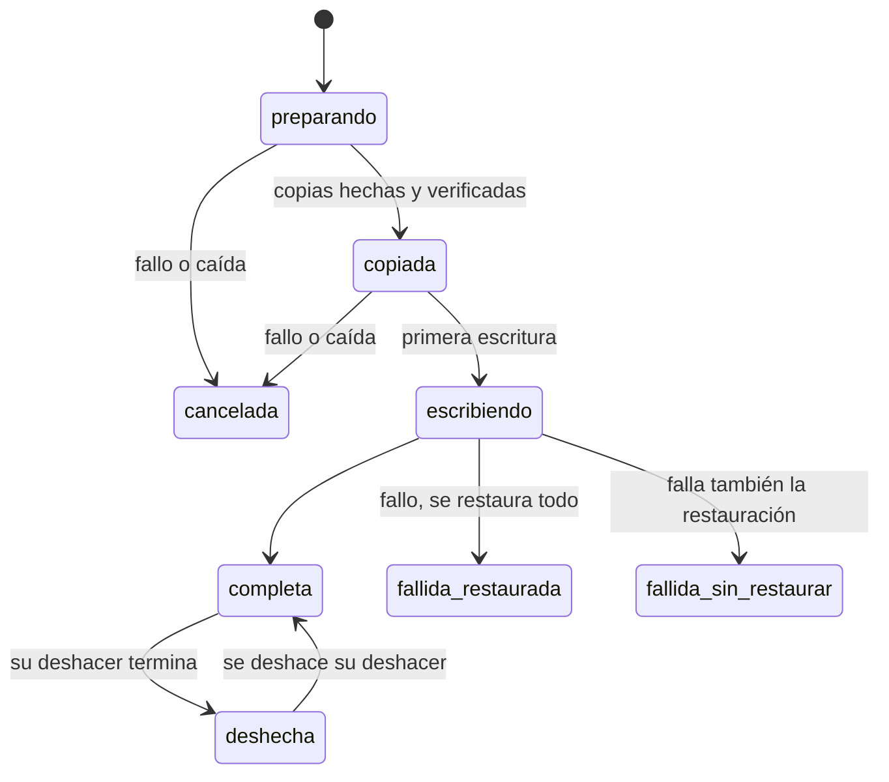

# Flujos de exportación e importación, backups e historial

Qué hace el jugador en cada paso, qué decide la app por él y qué puede pararlo. Los conceptos (plan, operación,
selección) están en [`modelo-de-datos.md`](modelo-de-datos.md); el paquete, en
[`formato-wowprofile.md`](formato-wowprofile.md); qué viaja de cada addon, en [`adaptadores.md`](adaptadores.md).

Marcas: **[V]** verificado, **[I]** inferencia, **[H]** hipótesis.

## Principios

- **Solo la operación escribe en `WTF`.** Todo lo anterior (leer, seleccionar, planificar, vista previa) se puede
  cancelar sin dejar rastro.
- **Lo que se ve es lo que se hace.** La vista previa enseña el plan tal cual; aplicar ejecuta ese plan y no
  otro.
- **Sin backup no hay escritura**, y el backup se guarda antes de tocar el primer fichero.
- **Con WoW abierto no se escribe.** Cualquier `Wow.exe` en marcha bloquea aplicar y deshacer. Forever y Retail
  usan el mismo nombre de ejecutable [V], así que no se intenta distinguir la versión: se bloquea siempre.

## Exportar

No escribe en `WTF` y no entra en el historial.

1. **Origen.** El jugador elige versión del juego, cuenta y personaje.
2. **Lectura.** La app lee los ficheros del personaje y de su cuenta, y decide qué ofrece de cada addon con el
   orden de [`adaptadores.md`](adaptadores.md#orden-de-decisión).
   - Con WoW abierto se puede exportar, avisando de que lo cambiado en la sesión actual no está en disco hasta
     salir del personaje o recargar la interfaz (`/reload`) [I].
   - Un fichero que no se puede leer como Lua (por ejemplo, porque el juego lo estaba escribiendo) se marca como
     no exportable, con el motivo. El resto sigue.
3. **Selección.** Por categoría y, en `config-addon`, por addon. Marcado por defecto:

   | qué | por defecto |
   |---|---|
   | macros, teclas, teclas de clic, opciones, chat, ventanas, Modo Edición, addons activos, marcos de banda | marcado |
   | pieza de un addon que sale de una regla de adaptador o de una variable AceDB | marcado |
   | pieza de un addon que sale de una regla genérica (de cuenta, por personaje o de cuenta con personajes) | **desmarcado**, con el aviso de su regla y las pistas que se hayan encontrado ([detalle](adaptadores.md#orden-de-decisión)) |
   | addon con `noExportar` o sin datos | no aparece |

   Se decide **por pieza, no por addon**: un mismo addon puede tener una variable AceDB, que viaja marcada, y otro
   fichero que cae en una regla genérica, que viaja desmarcado.

   «Marcar todos» marca de una vez las piezas genéricas de un tipo, **salvo las que tienen pistas** de otros
   jugadores: esas se marcan una a una, viendo su aviso.

   Una pieza genérica viaja tal cual, sin sustituir marcadores: puede llevar el nombre del personaje de origen y
   datos de otros jugadores. El aviso lo dice, porque el que se expone al marcarla es quien exporta.

4. **Datos del perfil.** Nombre (obligatorio) y descripción.
5. **Resumen.** Lo que va a viajar, el tamaño y los avisos. Siempre incluye una nota: **el contenido de los
   botones de las barras de acción no viaja** (lo guarda el servidor [V]). Sí viajan la disposición de las
   barras, las teclas de cada botón y las macros.
   - Si alguna pieza ya contiene `@@WOWPROFILE:`, se quita del paquete y se dice cuál.
   - Bloquea si se pasa de los límites del formato (256 piezas, 32 MiB por pieza, 128 MiB en total).
6. **Guardar.** Diálogo de guardar con `<nombre>.wowprofile` propuesto. Se escribe a un temporal y se renombra:
   un fallo no deja un `.wowprofile` a medias.

## Importar



### 1. Abrir el paquete

Diálogo de abrir o arrastrar el fichero. Se aplican los pasos 1 a 5 de
[«Leer un paquete de forma segura»](formato-wowprofile.md#leer-un-paquete-de-forma-segura); el 6 (traducir cada
`destino` a una ruta real) necesita el personaje destino y se hace al elegirlo. Si alguno falla, se dice cuál y no
se sigue: no hay paquetes «medio válidos».

Se enseña el resumen: nombre, descripción, fecha, versión del juego y clase de origen (si viene), y qué
categorías y addons trae.

### 2. Elegir el destino

Cuenta → personaje, **solo de la versión del juego del paquete** (`origen.producto`). Retail y Forever no se
mezclan: un paquete de Forever solo ofrece personajes de Forever, y uno de Retail, de Retail.

- Si en este equipo no hay ninguna instalación de ese producto, la app dice de qué versión es el paquete y no
  ofrece destinos. No es un error del paquete.
- Si la versión es la misma pero la interfaz no (`origen.interfaz` distinta de la del destino, por ejemplo tras
  una actualización del juego), se ofrece con aviso.
- Si la clase de origen se conoce y no coincide con la del destino, aviso. Nunca bloquea.
- Si el personaje no tiene carpeta, la app explica que tiene que entrar al juego una vez con él [I]. No crea
  carpetas de personaje.
- Elegido el destino, se traduce cada `destino` lógico a su ruta real y se comprueba que cae dentro de la carpeta
  del personaje o de su cuenta (paso 6 del formato).

### 3. Seleccionar

Las entradas del paquete, por categoría y, en `config-addon`, por addon. Para cada addon, «activado» y
«configuración» por separado.

| caso | por defecto |
|---|---|
| entrada normal | marcada |
| `config-addon` de tipo `fichero` (salió de una regla genérica) | **desmarcada**, con aviso: puede llevar estado o datos de otros jugadores. El paquete no lleva firma, así que no se fía de lo que eligió quien exportó |
| categoría o tipo desconocidos (paquete de una versión menor más nueva) | desmarcada, con aviso |
| adaptador desconocido o de una versión anterior | desmarcada, con aviso |
| addon del destino fuera del rango `versionesAddon` del adaptador (se compara con la versión instalada en el destino) | desmarcada, con aviso |
| addon no instalado en el destino | como si estuviera instalado (marcada, o desmarcada si es de tipo `fichero`), con el aviso «falta el addon» y su enlace si viene en el paquete [V: el cliente conserva el `SavedVariables` de un addon desinstalado; [H] lo carga al instalarlo] |
| entrada que afecta a toda la cuenta del destino: genéricos de cuenta y reglas de adaptador de `ambito: cuenta` que no se limitan a `soloPersonaje` | **sin decidir**: el jugador tiene que aceptarla o quitarla antes de aplicar |
| perfil AceDB con un nombre que ya existe en el destino | **sin decidir**: renombrar (propone `<nombre> (2)`) o sobrescribir |

Sobrescribir un perfil AceDB que ya existe cambia la configuración de **todos** los personajes del destino que lo
usan (los que lo apuntan en `profileKeys`). Si hay alguno además del destino, la opción se presenta con sus
nombres y cuenta como «afecta a toda la cuenta». Renombrar nunca toca a otro personaje, por eso es la opción
propuesta.

### 4. Vista previa

Es el plan de importación. Cinco grupos, los del encargo:

| grupo | qué contiene | detalle |
|---|---|---|
| **Nuevos** | ficheros que no existían | ruta y tamaño |
| **Modificados** | ficheros que se sobrescriben o en los que se fusiona un perfil | macros y teclas: elemento a elemento (macro añadida, cambiada o quitada; tecla cambiada). Lua: qué perfil o qué claves cambian. Los que afectan a toda la cuenta se señalan aparte |
| **Sin cambios** | entradas cuyo resultado es idéntico a lo que ya hay | no se escriben |
| **Conflictos** | lo que sigue sin decidir | no se puede aplicar hasta resolverlos |
| **Incompatibles** | entradas que no se pueden aplicar, con el motivo | no se escriben |

Debajo, los avisos y los bloqueos (WoW abierto, destino inexistente). «Aplicar» solo está activo sin bloqueos y
sin conflictos. Volver a la selección recalcula el plan.

### 5. Aplicar

Se crea una operación (ver [Operaciones en disco](#operaciones-en-disco)) y se ejecuta. Mientras dura, la app no
deja cerrar la ventana sin avisar.

### 6. Resultado

- **Completa**: qué se escribió y el siguiente paso, entrar al juego con ese personaje y comprobarlo. Recuerda
  que las habilidades de los botones las coloca el jugador: el perfil trae la disposición y las teclas, no el
  contenido. Botón «Deshacer».
- **Fallida y restaurada**: qué falló. El `WTF` está como antes.
- **Fallida sin restaurar**: qué falló, qué ficheros quedaron mal y dónde están las copias para restaurarlas a
  mano. No debería pasar nunca, pero si pasa se dice todo.

## Operaciones en disco

Cada importación y cada deshacer es una **operación**: una carpeta dentro de la carpeta de datos de la app.

```
<carpeta de datos>/operaciones/
  20261117-213045-a1b2c3d4/
    operacion.json        diario y metadatos (operacion.schema.json)
    copias/
      0                   contenido anterior del primer fichero que existía
      1
      …
```

- Las copias se nombran por número. La ruta real de cada una está en `operacion.json`; nunca se deduce del nombre.
- Sin base de datos. El historial es la lista de carpetas. Si la app deja de funcionar, cualquiera puede
  restaurar a mano copiando cada `copias/<n>` a su `ruta`.
- Todo se escribe con [escritura segura](#escritura-segura), `operacion.json` incluido.

### `operacion.json`

Esquema: [`operacion.schema.json`](operacion.schema.json).

| campo | qué es |
|---|---|
| `esquema` | `1` |
| `id` | `AAAAMMDD-HHMMSS-<8 hex>`, el mismo que la carpeta |
| `tipo` | `importacion` o `deshacer` |
| `creada`, `terminada` | RFC 3339 en UTC; `terminada` en cuanto llega a un estado final |
| `estado` | ver [Estados](#estados) |
| `paquete` | nombre del perfil y SHA-256 del fichero `.wowprofile` (solo en `importacion`) |
| `deshace` | `id` de la operación que deshace (solo en `deshacer`) |
| `deshechaPor` | `id` de la operación que la deshizo (solo con `estado: deshecha`) |
| `destino` | raíz de la versión del juego, producto, carpetas de cuenta, reino y personaje, y el nombre resuelto si se resolvió |
| `cambios[]` | uno por fichero: `ruta`, `accion`, `deCuenta`, `entrada` de origen (solo en `importacion`), `antes` (no existía, o hash, tamaño y copia) y `despues` (hash y tamaño, o no existe) |
| `error` | qué falló (obligatorio en los estados fallidos) |

Acciones:

| `accion` | en | qué hace |
|---|---|---|
| `crear` | `importacion` | escribe un fichero que no existía |
| `sobrescribir` | `importacion` | sustituye un fichero entero |
| `fusionar` | `importacion` | cambia solo algunas claves o un perfil dentro del fichero |
| `restaurar` | `deshacer` | devuelve un fichero a su contenido anterior |
| `borrar` | `deshacer` | quita un fichero que la importación había creado |

`ruta` es relativa a la raíz de la versión y siempre empieza por `WTF/Account/`. El schema solo comprueba la
forma. La app comprueba además, antes de escribir, que cada ruta cae dentro de la carpeta del personaje destino
(o de su cuenta si `deCuenta`), y rechaza los nombres que Windows no trata literalmente: los que acaban en punto o
espacio y los de dispositivo (`CON`, `NUL`…).

La raíz y las carpetas de la cuenta **nunca salen del equipo**: `operacion.json` no se comparte ni se exporta.

### Estados



En el fichero, los estados se escriben con guion: `fallida-restaurada`, `fallida-sin-restaurar`. Son finales
`completa`, `deshecha`, `cancelada`, `fallida-restaurada` y `fallida-sin-restaurar`.

### Escritura segura

Todo fichero que escribe la app (los del `WTF`, las copias y el propio `operacion.json`) se escribe a un temporal
en la misma carpeta, se vuelca a disco y se renombra encima del destino. Un corte de luz deja el fichero anterior
o el nuevo, nunca uno a medias [I: lo que garantiza un renombrado dentro de un mismo volumen NTFS; sin probar].

### Orden de escritura

1. Comprobar que no hay ningún `Wow.exe` en marcha y que cada fichero del plan sigue con el hash que leyó el plan.
   Si alguno cambió, no se crea nada y se pide volver a planificar.
2. Crear la carpeta con `estado: preparando` y todos los `cambios` con su `antes` y su `despues`.
3. Copiar cada fichero que existía a `copias/<n>`, releer la copia y comprobar que su hash es el `antes.sha256`
   del plan. Si no lo es (el fichero cambió entre medias), `cancelada` y volver a planificar.
4. `estado: copiada`. Hasta aquí el `WTF` no se ha tocado.
5. `estado: escribiendo`. Escribir cada fichero (o, en un `borrar`, quitarlo).
6. `estado: completa` y `terminada`.

Si algo falla en el paso 5, se restaura (ver abajo) y se pasa a `fallida-restaurada`.

**Restaurar** una operación es, para cada fichero ya tocado: comprobar que su copia sigue teniendo el hash
`antes.sha256`, escribirla con escritura segura y releer el resultado. Los que no existían se borran. Si una copia
no cuadra o una escritura falla, la operación queda en `fallida-sin-restaurar` y la app dice qué ficheros quedaron
mal y dónde están las copias que sí sirven.

### Al arrancar

La app recorre `operaciones/` buscando operaciones que no estén en un estado final:

| estado encontrado | qué significa | qué hace la app |
|---|---|---|
| `preparando`, `copiada` | se cortó antes de tocar el `WTF` | la marca `cancelada` y lo dice |
| `escribiendo` | se cortó a mitad: el `WTF` puede estar a medias | lo explica y ofrece restaurar. Si se restaura, `fallida-restaurada` |
| `operacion.json` ilegible | no se sabe en qué punto se cortó | avisa de que el `WTF` **puede** estar a medias, enseña la carpeta de copias y no borra nada |

Restaurar al arrancar exige lo mismo que aplicar: ningún `Wow.exe` en marcha. Si el juego está abierto, al salir
reescribiría los ficheros encima de la restauración.

Además, si una operación `deshacer` está `completa` y la que deshace no está `deshecha`, la marca `deshecha`: el
corte fue entre los dos pasos del deshacer.

## Deshacer

Deshacer devuelve los ficheros de una operación `completa` a como estaban antes.

1. **De la más nueva a la más antigua.** Si una operación posterior `completa` tocó alguno de los mismos ficheros,
   no se puede deshacer esta hasta deshacer aquella, y la app dice cuál. Así nunca se pisa en silencio una
   importación más reciente.
2. **Mismo juego.** Se comprueba que la raíz de la versión existe y que su producto (`.flavor.info`) es el del
   `destino`. Si no (instalación movida, borrada o reinstalada con otra versión), no se escribe nada y se dice
   dónde están las copias.
3. Para cada cambio, se compara el hash actual con el `despues` de la operación. **Lo normal es que no
   coincidan**: el jugador entra al juego para comprobar la importación y, al salir, el cliente reescribe los
   `SavedVariables` [V: medido en la Fase 1]. No es un error: la app enseña qué ficheros han cambiado desde la
   importación y avisa de que **lo que el juego guardó en ellos desde entonces se pierde** (por ejemplo, el
   progreso de esa sesión en ese addon).
4. Los ficheros `deCuenta` se señalan aparte: restaurarlos devuelve a su estado anterior la configuración de ese
   addon para **todos** los personajes de la cuenta.
5. Si el jugador confirma, se crea una operación `deshacer` con el mismo orden de escritura: primero copia el
   estado actual y después restaura. Cuando termina, la original pasa a `deshecha`, con `deshechaPor`.

**Deshacer un deshacer** vuelve a dejar los ficheros como tras la importación. El `deshacer` pasa a `deshecha` y
la importación original vuelve a `completa` (sin `deshechaPor`), así que se puede volver a deshacer.

El MVP restaura cada fichero entero. Quitar solo el perfil importado de un fichero de cuenta, sin tocar el resto,
queda para más adelante.

## Historial

Una lista de operaciones, de la más nueva a la más antigua: fecha, tipo, personaje destino, perfil, estado y
tamaño de sus copias. Arriba, el total ocupado.

- **Nada se borra solo.** Un solo fichero de cuenta puede pesar 9,5 MB [V: el mayor `SavedVariables` de una
  cuenta medida], y una importación que fusiona en varios ocupa lo que sumen. El jugador decide cuándo liberar
  espacio.
- **Borrar** una operación borra su carpeta y con ella la posibilidad de deshacerla. Se confirma diciéndolo así.
  - No se puede borrar una operación en un estado no final.
  - Una `fallida-sin-restaurar` solo se borra tras confirmar que el jugador ya restauró a mano: sus copias pueden
    ser lo único que queda del estado anterior.
  - Si se borra una operación que otra `deshacer` referencia, esa otra muestra «operación borrada».
- **Abrir la carpeta** de una operación en el explorador, para restaurar a mano si hiciera falta.
