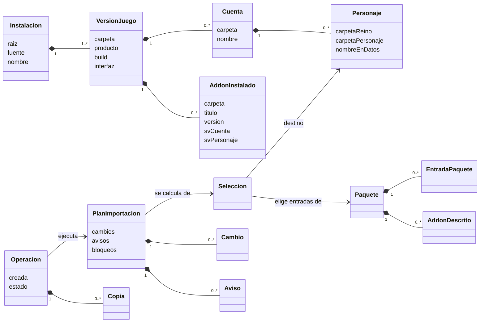

# Modelo de datos

Los conceptos con los que trabaja WoW Profile Manager, cómo se identifican y las reglas que ninguna parte del
código puede romper. Es la base de los tipos de la aplicación. El formato del paquete está en
[`formato-wowprofile.md`](formato-wowprofile.md) y lo medido en
[`compatibilidad-wow-forever.md`](compatibilidad-wow-forever.md).

Marcas: **[V]** verificado, **[I]** inferencia, **[H]** hipótesis.

## Tres zonas

| zona | qué contiene | efectos |
|---|---|---|
| **Lo que hay en disco** | instalación, versión del juego, cuenta, personaje, addon instalado | solo lectura |
| **Lo que viaja** | paquete y sus entradas | ninguno: es un valor |
| **Lo que se decide y se hace** | selección, plan de importación, operación | solo la operación escribe |



## Lo que hay en disco

### Instalación

Una carpeta raíz de WoW en este equipo.

| campo | origen |
|---|---|
| `raiz` | ruta absoluta. **Nunca sale del equipo** (no va al paquete) |
| `fuente` | `registro`, `battlenet` o `manual` |
| `nombre` | nombre propio que pone el usuario («Casa»); sin él, «Instalación N» junto a la ruta |
| `versiones` | las subcarpetas con juego dentro |

**Detección**, en este orden. Se juntan los resultados y se quitan las rutas repetidas (sin distinguir mayúsculas,
separador final ni `/` de `\`), y gana la primera fuente:

1. **Registro de Windows**: `Uninstall\World of Warcraft`, valor `InstallLocation` [V].
2. **Agente de Battle.net**: `C:\ProgramData\Battle.net\Agent\product.db` lista cada raíz con sus subcarpetas
   y versiones [V]. Es un formato binario sin documentar: se usa como **pista** y nunca se da por buena una ruta
   sin comprobarla en disco. Si no existe o no se entiende, se sigue sin él y sin error visible.
   Medido: es **protobuf** sin esquema publicado [V]. El campo `1`, repetido, es un producto instalado; dentro, `2` es
   el código (`agent`, `bna`, `wow`, `wowf`…) y `3` sus ajustes de instalación, con `1` la raíz escrita con `/`
   (`C:/Juegos/World of Warcraft`), `2` la región (`eu`) y `13` la subcarpeta (`_retail_`, `_forever_`) [V]. Solo se
   leen los productos cuyo código empieza por `wow`; `wow` y `wowf` comparten raíz [V].
3. **Manual**: el usuario elige una carpeta. Siempre está disponible, aunque las otras fuentes no encuentren
   nada. Se recuerda entre arranques; si deja de existir, se lista como «no encontrada» hasta que se quita.

Las carpetas a mano y los nombres propios viven en `preferencias.json`, en la carpeta de datos de la app y
**nunca dentro de una instalación**. La clave de una instalación es su raíz normalizada (sin mayúsculas ni
separador final); la de una cuenta, raíz + carpeta de versión + carpeta de cuenta. Quitar una carpeta a mano
borra también sus nombres.

Regla: una carpeta solo es una instalación si tiene `.build.info` en su raíz [V].

### Versión del juego

Una subcarpeta de la instalación (`_retail_`, `_forever_`…).

| campo | origen |
|---|---|
| `carpeta` | nombre de la subcarpeta |
| `producto` | `<carpeta>/.flavor.info`: `wow` en `_retail_`, `wowf` en `_forever_` [V] |
| `build` | `.build.info` de la raíz, columna `Version` de la fila cuyo `Product` coincide [V] |
| `interfaz` | `WTF/Config.wtf`, `SET engineSurveyPatch` (`16001` en Forever, `120105` en Retail) [V] |

- La app trabaja con `wowf` y `wow`. Los demás productos se listan como «no soportado».
- Si `Config.wtf` no tiene `engineSurveyPatch`, la versión no se puede exportar todavía. [H] Basta con abrir el
  juego una vez, porque el cliente lo escribe.

### Cuenta

Una carpeta de `WTF/Account/`.

- Identidad: (instalación, versión, carpeta).
- `nombre`: nombre propio que pone el usuario («Principal»); sin él, «Cuenta N» del `#N` de la carpeta.
- Solo cuentan las carpetas con forma `<número>#<número>` [V]. Las demás (por ejemplo una copia `…#1.back`, o
  `SavedVariables`) se ignoran y se dice cuántas.
- Tiene sus `SavedVariables/` y sus ficheros de cuenta (`macros-cache.txt`, `bindings-cache.wtf`…).

### Personaje

Una carpeta `WTF/Account/<cuenta>/<reino>/<personaje>/`.

| campo | qué es |
|---|---|
| `carpetaReino`, `carpetaPersonaje` | **identidad**, junto con la instalación, la versión y la cuenta |
| `nombreEnDatos` | cómo aparece en los `SavedVariables`; **se resuelve**, puede quedar sin resolver |

**El nombre de la carpeta no es el nombre del personaje** [V]. En un mismo reino conviven una carpeta con `ø`
en el nombre y otra con el nombre en ASCII y un sufijo hexadecimal (`…8D31D`). Por eso:

- La identidad es la carpeta, nunca el nombre. Dos personajes con la misma carpeta en dos instalaciones son
  personajes distintos: la interfaz enseña siempre de qué instalación es cada uno.
- `nombreEnDatos` se resuelve en este orden:
  1. De los datos: una clave de personaje que exista en los `SavedVariables` de la cuenta (`profileKeys` y
     similares) y case con la carpeta.
  2. De la carpeta. En Forever, `Nombre-Apellido` → `"Nombre Apellido"` [V]. En Retail, `"Nombre - Reino"`.
  3. Si nada cuadra, se pregunta al usuario. **Nunca se inventa.**
- Las claves de personaje de la regla 1 son las de cada tabla `profileKeys` con `profiles` al lado (AceDB), en
  los `.lua` de `<cuenta>/SavedVariables`. En Forever la clave no lleva reino (`"Goldberg Joestar"`) [V]; en
  Retail sí (`"Gøldberg - Sanguino"`) [V]. La coincidencia es exacta: los datos confirman el candidato de la
  carpeta, no buscan parecidos. El resultado dice de dónde sale: `datos` o `carpeta`.
- Una carpeta con sufijo (`Goldber8D31D`, `Bison2D457`) lleva los 5 últimos caracteres del GUID del personaje
  (`character-list-order.txt`: `1379-0928D31D`) [V]. Los nombres de WoW no llevan cifras [I], así que de una
  carpeta con cifras no sale ningún nombre: queda sin resolver.
- El nombre interno del reino en Forever (`CAMWOW EU5 Realm 4 PvP`) no aparece en ninguna ruta [V]. Si un
  adaptador lo necesita, sale de los datos del propio destino.

**Reinos de otra versión.** Dentro del `WTF` de una versión puede haber carpetas de reino copiadas a mano de la
otra [V: medido una vez]. Retail y Forever no se mezclan, así que esas carpetas no se listan; se dice cuántas se
ignoran, igual que con las cuentas que no tienen forma de cuenta.
- En Forever, los personajes están en carpetas de reino numéricas (`93`) [V en una instalación; H como regla
  general]. En Retail, la carpeta de reino es el nombre del reino [V].
- Como la regla de Forever es [H], el recuento de carpetas ignoradas está siempre a la vista: si la regla se
  equivoca en alguna instalación, se nota.

**Destino válido.** El personaje destino tiene que haber entrado al juego al menos una vez, porque el cliente
crea su carpeta al entrar [I]. Si no existe, la app lo explica; no crea carpetas de personaje.

### Addon instalado

Una carpeta de `Interface/AddOns/` con su `.toc`.

| campo | origen |
|---|---|
| `carpeta` | identidad, junto con la versión |
| `titulo`, `version`, `enlace`, `dependencias` | `.toc`. De 62 addons medidos: `Version` en 58, enlace en 27 y dependencias en 34 [V] |
| `svCuenta`, `svPersonaje` | `## SavedVariables` y `## SavedVariablesPerCharacter` del `.toc` |

- El juego solo carga un `.toc` con el nombre de su carpeta: una carpeta `X-bak` con `X.toc` no se carga [V].
  Primero se busca el del tipo de juego y después el general: Forever `<carpeta>_Camelot.toc` [V] (hay addons
  que solo traen ese) y Retail `<carpeta>_Mainline.toc` [I]; si no, `<carpeta>.toc`. Las carpetas sin `.toc`
  cargable se cuentan, no se listan.
- Del `.toc` se lee: `Title` (sin códigos de color `|c…|r`), `Version`, `X-Website` como enlace, `Dependencies`
  y `RequiredDeps` como dependencias (`OptionalDeps` no lo es), `SavedVariables` y `SavedVariablesPerCharacter`.
  Las claves no distinguen mayúsculas; BOM y CRLF no afectan [V: 226 `.toc` medidos].
- El `.toc` es una pista: lo que cuenta es qué ficheros hay en disco [V].
- Un `SavedVariables` es AceDB si su tabla tiene `profileKeys` y `profiles` [I]. Se decide por los datos, no
  por la librería que trae el addon.
- Los addons que aparecen en `AddOns.txt` pero no están instalados se ignoran al exportar [V].

## Lo que viaja

### Paquete y entradas

El manifiesto y las piezas de [`formato-wowprofile.md`](formato-wowprofile.md). En memoria es un valor
inmutable: se lee, se valida entero (hashes incluidos) y a partir de ahí no cambia.

La exportación es el camino inverso, y tampoco escribe nada en `WTF`:
`exportar(personaje origen, selección de exportación, disco leído) → Paquete`.

## Lo que se decide y se hace

### Selección

Lo que el usuario elige al importar:

- El personaje destino.
- Qué entradas se aplican. Para cada addon, «activado» y «configuración» por separado.
- Las respuestas a lo que pide decisión:
  - Si ya hay un perfil AceDB con ese nombre: renombrar o sobrescribir.
  - Las entradas que afectan a toda la cuenta: aceptadas o no.

### Plan de importación

```
planificar(paquete, selección, disco leído) → Plan
```

**Es puro**: no escribe nada y, con la misma entrada, da siempre el mismo plan. La vista previa enseña el plan
tal cual, así que lo que se ve es exactamente lo que se hará.

| parte | qué lleva |
|---|---|
| `cambios` | uno por fichero: ruta real, acción (`crear`, `sobrescribir` o `fusionar` un perfil), hash del fichero leído (o «no existía»), contenido nuevo y su hash, entrada de origen, y si afecta a toda la cuenta |
| `avisos` | no impiden aplicar: clase distinta, interfaz distinta dentro de la misma versión del juego, falta un addon, adaptador desconocido |
| `bloqueos` | impiden aplicar: WoW abierto, paquete inválido, destino inexistente |

Reglas:
- Toda ruta de un cambio está **dentro** de la carpeta del personaje destino o de su cuenta.
- Ningún cambio toca a otro personaje, salvo los marcados «afecta a toda la cuenta» que el usuario aceptó.
- Un plan con bloqueos no se ejecuta.

### Operación

```
ejecutar(plan) → Operación
```

Es lo único que escribe:

1. Comprueba que WoW está cerrado y que **cada fichero sigue con el hash que leyó el plan**. Si alguno cambió
   (por ejemplo, el juego se abrió y se cerró entre medias), no escribe nada y pide volver a planificar.
2. Hace el **backup** de todo lo que va a tocar, antes de la primera escritura.
3. Escribe cada fichero en un temporal y lo renombra encima del original (escritura atómica).
4. Si algo falla, restaura el backup entero y registra la operación como fallida.

| campo | qué es |
|---|---|
| `creada`, `destino`, `paquete` | cuándo, dónde y qué se importó (nombre del perfil y hash del fichero) |
| `cambios` | por cada fichero tocado: `antes` (su copia y su hash, o «no existía») y `despues` |
| `estado` | `completa`, `deshecha`, `fallida-restaurada`… (lista completa en [`flujos.md`](flujos.md#estados)) |

**Deshacer** restaura el backup de una operación, y es a su vez otra operación. Antes compara los ficheros con el
hash que dejó la operación. Lo normal es que no coincidan, porque el juego los reescribe al salir: la app lo
explica y deja elegir.

Las operaciones y sus backups se guardan como ficheros, una carpeta por operación, dentro de la carpeta de datos
de la app. El detalle, el orden de escritura y el historial están en [`flujos.md`](flujos.md).
